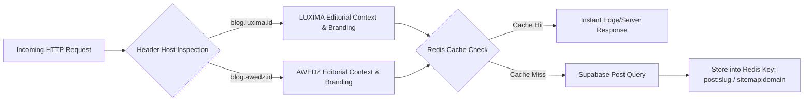

# LUXIMA Blog & Editorial Journal — System Architecture & Multi-Domain Specification (Archify Blueprint)

## 1. Ikhtisar Arsitektur Majalah & Blog Editorial (`luxima-blog`)

`luxima-blog` adalah platform publikasi konten mewah, majalah editorial pernikahan, dan mesin pendorong SEO organik dalam ekosistem LUXIMA. Dibangun menggunakan arsitektur gabungan **Astro v7 SSR** (Server-Side Rendering) dan **Hono v4 Backend Bridge** yang berjalan pada runtime **Bun**.

Aplikasi ini melayani dua domain publik secara dinamis dari satu basis kode:
- **`https://blog.luxima.id`**: Jurnal mewah editorial pernikahan, tren gaun pengantin, inspirasi floral, dan profil vendor atelier.
- **`https://blog.awedz.id`**: Panduan pernikahan, direktori tradisi adat nusantara, dan tips budgeting pernikahan untuk pasangan muda.

```mermaid
graph TD
    Client["Readers & Search Crawlers (Google, Bing, Social Bots)"]
    CF["Cloudflare Edge CDN (Edge Caching & SSL)"]
    Server["Astro SSR + Hono Backend (Bun Runtime)"]
    Redis["Upstash / Dragonfly Redis (Article & Sitemap Cache)"]
    DB[("Supabase PostgreSQL (Tables: posts, categories, tags, comments)")]
    R2["Cloudflare R2 (Hero Images, WebP & Fallbacks)"]

    Client -->|blog.luxima.id / blog.awedz.id| CF
    CF --> Server
    Server -->|Read / Write Content| DB
    Server -->|Cache-Aside (TTL 3600s)| Redis
    Server -->|Serve Optimized Media| R2
```

---

## 2. Topologi Multi-Domain Dinamis & Cache Invalidation

Arsitektur blog dirancang untuk merespons konteks domain pemanggil secara mulus:



### Fitur Kunci Multi-Domain:
1. **Dynamic Base URL Extraction**: Sitemap dinamis (`/api/sitemap.xml`) dan `robots.txt` membaca header `x-forwarded-host` / `host` untuk menghasilkan URL canonical yang tepat bagi `blog.luxima.id` maupun `blog.awedz.id`.
2. **Domain-Isolated Sitemap Caching**: Kunci cache sitemap diisolasi berdasarkan domain (`sitemap:xml:https://blog.luxima.id` vs `sitemap:xml:https://blog.awedz.id`), mencegah konflik URL antar-domain.
3. **Structured Data JSON-LD Dinamis**: Metadata Schema.org (Organization & WebSite) menyesuaikan identitas penerbit (`publisher`) secara otomatis sesuai domain yang diakses.

---

## 3. Optimasi Editorial, AEO (AI Engine Optimization) & SEO

- **Core Web Vitals**: Menggunakan font web modern, kompresi aset gambar via Cloudflare Image Resizing / R2, dan rendering Astro SSR berkecepatan tinggi.
- **Schema.org Graph**: JSON-LD terstruktur untuk entitas *Article*, *Organization*, *WebSite*, dan *BreadcrumbList* guna mendominasi hasil pencarian mesin AI (Google SGE, Perplexity, ChatGPT Search).
- **Botanical Luxury Design**: Menggunakan palet warna natural terkurasi (`emerald`, `gold`, `stone`, `cream`), tipografi serif elegan (*Playfair / Cormorant*), dan micro-animations halus.

---

## 4. Checklist Kesiapan Produksi (Production Readiness)

- [x] **Astro SSR Server Build**: `bun astro build` selesai sukses tanpa error (@astrojs/node adapter).
- [x] **Automated Test Suite**: 11/11 unit tests lulus (Sanctuary resolver & slug generator).
- [x] **Multi-Domain Host Routing**: Dukungan penuh untuk `blog.luxima.id` dan `blog.awedz.id`.
- [x] **Security Headers & CSP**: HSTS (`max-age=31536000`), X-Frame-Options DENY, X-Content-Type-Options nosniff, dan CSP Whitelist.
- [x] **Dynamic Sitemap & Robots.txt**: XML sitemap dengan auto-caching Redis (TTL 1 jam) dan sanitasi entitas XML.
